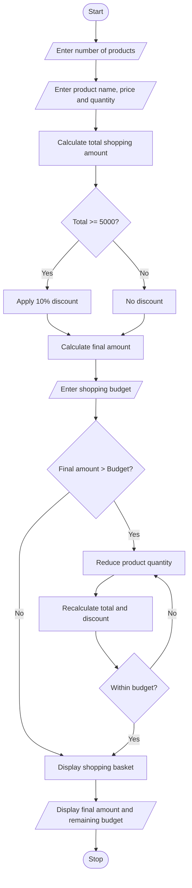

# Multi-Product Shopping Budget Constraint Using Python

## 1. Problem Statement

Develop a Python program to evaluate a shopping basket containing multiple products and their quantities. Calculate the total cost of all products, apply discount conditions, and compare the final amount with a fixed budget. If the total cost exceeds the budget, identify which product quantities must be reduced to stay within the given budget.

## 2. Algorithm

1. Start the program.
2. Read the number of products.
3. Enter the name, price, and quantity of each product.
4. Calculate the total price of each product.
5. Calculate the total shopping amount.
6. Apply a 10% discount if the total amount is ₹5,000 or more.
7. Calculate the final amount after discount.
8. Enter the fixed shopping budget.
9. Compare the final amount with the budget.
10. If the amount is within the budget, display the shopping details.
11. Otherwise, reduce product quantities until the total amount fits within the budget.
12. Display the updated shopping basket and final amount.
13. Stop the program.


## 5. Sample Input

```
Enter number of products: 3

Enter product name: Rice
Enter price: 1000
Enter quantity: 2

Enter product name: Oil
Enter price: 200
Enter quantity: 5

Enter product name: Sugar
Enter price: 100
Enter quantity: 5

Enter your budget: 3000
```

## 6. Sample Output

```
Original Total: 4000.0
Discount: 0
Amount after discount: 4000.0

Budget exceeded!
Reducing product quantities...

Final Shopping Basket

Rice Quantity: 1
Oil Quantity: 5
Sugar Quantity: 5

Final Total: 3000.0
Discount: 0
Final Amount: 3000.0
Remaining Budget: 0.0
```

## 7. Mermaid Flowchart Code


## 8. Conclusion

This Python program calculates the total shopping cost, applies discount conditions, and compares the final amount with the available budget. If the budget is exceeded, it reduces product quantities and displays the updated shopping basket within the budget.

Concepts used: Lists, loops, conditional statements, arithmetic operators, and the `sum()` function.
